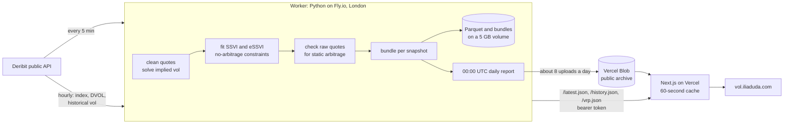

# vol-surface-live

A live implied-volatility surface for Bitcoin and Ether options, built from Deribit's free public API. Every five minutes a worker pulls every listed option, cleans the quotes, fits two surface models (SSVI and extended SSVI) under no-arbitrage constraints, checks the raw quotes for static arbitrage, and publishes the result. Each day at 00:00 UTC it writes a JSON report of what changed.

Live page: https://vol.iliaduda.com

## Why

An implied-volatility surface is the standard way to read an options market: one picture of how much movement is priced, at which strikes and for which dates. Building one from real quotes means dealing with stale and crossed markets, solving implied vols correctly, fitting a model that cannot produce arbitrage, and being clear about where the model does not fit. This project does all of that in the open, with tests, on data anyone can check.

## How it works



### Data

- `get_book_summary_by_currency` (one call per currency) gives bid, ask and mark price, mark IV, the forward for each expiry, open interest and volume for every option. `get_instruments` gives strikes and exact expiry times.
- Implied vols are solved from bid and ask prices with Black-76 on Deribit's forward at zero rates, which is Deribit's own convention. Coin prices are converted to USD with that forward.
- Each run also fetches ten `ticker` responses and compares our IVs with Deribit's published `bid_iv` and `ask_iv`. They agree to Deribit's two-decimal rounding (0.005 vol points), apart from the occasional ticker whose IV disagrees with its own price; those are counted in every bundle.
- About two dozen requests per currency per run, with a 5 requests per second token bucket and backoff on rate-limit errors.

### Cleaning

Each quote gets the first reason that applies, and every dropped quote keeps its reason:

| Rule | Kind |
|---|---|
| Expiry less than 2 days away | selection |
| In the money (the fit uses out-of-the-money options) | selection |
| No bid / no ask | quality |
| Bid at or above ask | quality |
| Bid at or below intrinsic value | quality |
| Implied vol could not be solved | quality |
| Spread wider than 15 vol points or 50% of mid | quality |

Thresholds live in `worker/src/volsurf/config.py`, and the page prints them from the data.

### Model

SSVI (Gatheral and Jacquier, 2014) with a power-law φ:

```
w(k, θ) = θ/2 · [1 + ρφk + √((φk + ρ)² + 1 − ρ²)]
φ(θ)    = η θ^(−γ) (1 + θ)^(γ − 1)
```

`w` is total implied variance σ²T at log-moneyness k = ln(K/F). Each expiry has its own θ (its at-the-money total variance); ρ, η and γ are shared.

- **No calendar arbitrage:** θ is fitted as cumulative non-negative increments, so it never falls with expiry (Theorem 4.1). For the power-law φ with 0 < γ < 1 the theorem's second condition holds automatically; the proof is in the `ssvi.py` docstring.
- **No butterfly arbitrage:** η(1 + |ρ|) ≤ 2 with 0 < γ ≤ ½ (Corollary 4.1), plus both inequalities of Theorem 4.2 at every fitted θ, as SLSQP constraints.
- **Objective:** squared error in implied vol against the bid-ask mid, weighted by vega over spread, each expiry counting equally. The fit never targets Deribit's mark IV, which is itself a model.
- After every fit the surface is checked on a grid: Durrleman's g(k) ≥ 0 and ∂w/∂T ≥ 0.
- Fit error is reported per expiry as RMSE in vol points and as the share of quotes where the fit sits inside the bid-ask spread.

### Extended SSVI and the choice between models

Extended SSVI (Hendriks and Martini, 2019) keeps the SSVI slice but gives every expiry its own skew ρ and slope ψ = θφ.

- **No calendar arbitrage:** θ and ψ never fall with expiry, and |ρ₂ψ₂ − ρ₁ψ₁| ≤ ψ₂ − ψ₁ between neighbouring expiries, so neither wing's asymptotic slope ψ(1 ± ρ)/2 falls with maturity.
- **No butterfly arbitrage:** at each expiry, ψ(1 + |ρ|) < 4 and ψ²(1 + |ρ|) ≤ 4θ.
- **Between expiries:** θ follows a monotone cubic in T; ψ and ρψ are linear in θ, which keeps the calendar condition.
- Every fit is checked on a grid that includes the slices between expiries.

eSSVI contains SSVI, so it always fits the same quotes at least as well. To choose fairly, both models are refitted every snapshot with every fifth quote held out, and the page defaults to the one with the lower median error on the held-out quotes over the last hour (`selection` in every bundle). On all 129 snapshots archived on 19 October 2026 (`paper/data/model-comparison-2026-10-19.json`):

| | Median hold-out error, eSSVI / SSVI (vol pts) | Median share of quotes inside bid-ask, eSSVI / SSVI |
|---|---|---|
| BTC (65 snapshots) | 1.20 / 1.51 | 68% / 40% |
| ETH (64 snapshots) | 1.42 / 1.82 | 73% / 37% |

eSSVI had the lower hold-out error in every snapshot. ETH's unweighted in-sample median error by expiry was higher with eSSVI (1.53 against 1.39), because both fits weight tight at-the-money quotes over wide wings. Regenerate with `uv run python -m volsurf.evaluate <raw parquet files> --out results.json`.

### Checks on raw quotes

Vertical spreads (call prices fall with strike, by no more than the strike gap), butterflies (call prices convex in strike) and calendar spreads (total variance rises with expiry at fixed k). Puts become call-equivalents by put-call parity on the forward. Each check runs twice: at mid prices ("mid-quote violation") and at executable prices, buying at the ask and selling at the bid ("tradeable at quoted prices").

### Derived quantities

At-the-money term structure √(θ/T); 25-delta risk reversal and butterfly per expiry and at 7, 30, 60, 90 and 180 days, using forward (not premium-adjusted) delta; Dupire local vol from analytic SSVI derivatives and a monotone cubic θ(T).

### Implied against realized

Hourly, the worker reads a year of Deribit's index (every six hours), DVOL (Deribit's 30-day implied volatility index, daily) and Deribit's published historical volatility. Realized volatility is the annualized root mean square of six-hour log returns over 30 days, counted only when the data reaches both ends of the window. The page shows DVOL and our 30-day ATM vol against trailing realized vol, and DVOL minus the realized vol of the following 30 days: the volatility risk premium as it turned out. As computed at 02:22 UTC on 20 October 2026 (archived in `paper/data/vrp-2026-10-20T0223Z.json`): from 21 October 2025 to 20 September 2026, DVOL was above the following 30 days' realized vol on 89% of 335 days for bitcoin (median 11.9 points) and 90% for ether (median 17.7).

### Daily report

At 00:00 UTC: ATM vol, risk reversal and butterfly by tenor with 24-hour changes, the five biggest moves on a tenor × delta grid, arbitrage counts across the day's snapshots, fit quality, and data completeness. The schema is in `schema/report.schema.json`.

## Run it

Worker (Python 3.12+, [uv](https://docs.astral.sh/uv/)):

```sh
cd worker
uv sync
uv run volsurf snapshot          # one snapshot of BTC and ETH into ./data
uv run volsurf serve             # scheduler + HTTP server on :8080
uv run volsurf report --date 2026-10-19
uv run pytest                    # 65 tests, offline
```

Web (Node 22, pnpm):

```sh
cd web
cp .env.example .env.local       # point WORKER_URL at the worker
pnpm install
pnpm dev
pnpm test && pnpm build && pnpm e2e && pnpm lhci
```

## Tests

- **Worker (pytest + hypothesis):**
  - Black-76 prices and Greeks against QuantLib to 1e-10, plus a textbook value and finite differences.
  - Implied-vol round trips.
  - SSVI with known parameters recovers them to 1e-4; eSSVI recovers known per-expiry skews to 1e-3.
  - The constraints hold after fitting random surfaces.
  - The arbitrage checks fire on deliberately broken inputs (concave prices, slopes below −1, total variance falling with expiry, a slice with g(k) < 0, a crossing pair of eSSVI expiries) and stay quiet on clean ones.
  - Local vol equals implied vol on a flat surface and matches a closed form for a time-dependent one.
  - Realized vol on an exact series and a simulated one, the window coverage rule, and the forward-gap alignment.
  - Report units and signs, schema validation, endpoints (including token checks), Blob upload headers and budget, hourly snapshot selection.
- **Web (Vitest):** the TypeScript SSVI and eSSVI match the Python implementation to 12 decimal places; blended frames keep the calendar condition; the slimmed client bundle round-trips.
- **Web (Playwright, 20 tests):** zero console errors; each hero number once in the server HTML; stale snapshots stated in the server HTML; axe with no violations; keyboard use of both toggles and the history slider; reduced motion; the fallback when WebGL is unavailable; no horizontal scroll at 375, 768, 1440 and 2560 px.
- **Lighthouse CI:** 90 or more in every category, mobile and desktop.
- **Copy:** a copy check fails the build on em dashes or hype words.

## Limitations

- Deribit quotes only. This describes one venue's order book; it is not a trading signal.
- SSVI's single ρ cannot follow skew that changes with maturity; eSSVI can, but neither reproduces every quote. Per-expiry errors for both models are in every snapshot.
- "Tradeable at quoted prices" ignores fees, margin and size.
- Snapshots are five minutes apart; nothing in between is seen.

## Independence

Built independently from public data. No proprietary code, data or parameters were used.

## Licence

MIT. Deribit data is used under Deribit's public API terms.
